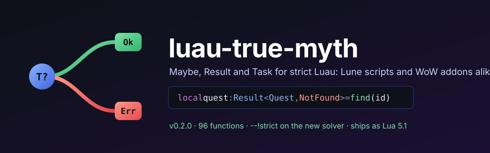

<p align="center">
  
</p>

<p align="center">
  <a href="https://braden1996.github.io/luau-true-myth/"></a>
  <a href="https://github.com/Braden1996/luau-true-myth/actions/workflows/ci.yml"></a>
  <a href="https://github.com/Braden1996/luau-true-myth/releases/latest"></a>
  <a href="LICENSE"></a>
  
  
</p>

**Optional values, errors and async results as typed values for strict [Luau](https://luau.org), without nil
checks you can forget or errors you can't see.** This is a port of [true-myth](https://github.com/true-myth/true-myth)
to Luau. It is redesigned around plain tagged tables, and its types are checked under luau-lsp's new solver. It runs
in [Lune](https://lune-org.github.io/docs) and, compiled to Lua 5.1, in World of Warcraft addons.

**Documentation:** <https://braden1996.github.io/luau-true-myth/> (guides and an API reference generated from the
source).

```luau
--!strict
local Result = require("./luau-true-myth/src/Result")

type NotFound = { read kind: "NotFound", read id: number }

local function findQuest(id: number): Result.Result<Quest, NotFound>
	local quest = QUESTS[id]
	if quest == nil then
		return Result.err({ kind = "NotFound", id = id } :: NotFound)
	end
	return Result.ok(quest)
end

local found = findQuest(42)
print(found.value)                      -- error: Key 'value' is missing from 'Err<NotFound>'
if found.kind == "Ok" then
	print(found.value.title)            -- fine: narrowed to Ok<Quest>
end
local title = Result.mapOr(findQuest(7), "?", function(q: Quest): string
	return q.title
end)
found.value = nil                       -- error: Property value of table 'Ok<Quest>' is read-only
```

## Contents

- [Why](#why)
- [Install](#install)
- [Guide](#guide)
- [API](#api)
- [Design and differences from true-myth](#design-and-differences-from-true-myth)
- [Development](#development)
- [Credits and licence](#credits-and-licence)

## Why

- **Absence and failure in the types.** `Maybe<T>` says a value may be missing. `Result<T, E>` says an operation
  can fail and with which errors. `Task<T, E>` is a `Result` that arrives later. The checker makes you handle every
  case before you touch the value.
- **Errors are values, not raises.** A failure is returned as a tagged table, so its type is part of the signature
  and composes: `Result.andThen` unions the error types of each step.
- **Exhaustive.** `Result.match` requires both handlers, and `Exhaustive.casesHandled` makes any `if`/`elseif`
  chain over a tagged union fail to type-check when a case is missing.
- **Plain data.** Every value is a read-only table such as `{ kind = "Ok", value = 1 }`, with no metatables, so it
  survives WoW SavedVariables and JSON unchanged.
- **One library, two runtimes.** The same tests run against the Luau sources (Lune) and against the darklua-built
  Lua 5.1 bundle in a Lua 5.1-only environment (WoW).
- **Types tested like code.** Fixtures pin luau-lsp's exact errors for misuse, so a solver upgrade cannot quietly
  weaken them.

## Install

The library is the `src/` folder: Luau modules with no dependencies.

**With [woof](https://github.com/Braden1996/woof) (recommended):** add to `woof.toml` and run `woof install` (or `sgt install` with [Sergeant](https://github.com/Braden1996/sergeant)'s `"woof"` plugin):

```toml
[dependencies]
truemyth = { github = "Braden1996/luau-true-myth", tag = "v0.2.0", asset = "luau-true-myth-0.2.0.zip", subpath = "src" }
```

Then require modules directly via `@truemyth`:

```luau
local TrueMyth = require("@truemyth/TrueMyth")
local Maybe, Result, Task = TrueMyth.Maybe, TrueMyth.Result, TrueMyth.Task
type Result<T, E> = TrueMyth.Result<T, E>
```

**Lune and other Luau projects (manual):** copy `src/` from a [release](https://github.com/Braden1996/luau-true-myth/releases/latest)
(`luau-true-myth-<version>.zip`) or add the repository as a git submodule, then require a module or the entry point:

```luau
local TrueMyth = require("./vendor/luau-true-myth/src/TrueMyth")
local Maybe, Result, Task = TrueMyth.Maybe, TrueMyth.Result, TrueMyth.Task
type Result<T, E> = TrueMyth.Result<T, E>
```

**WoW addons written in Luau** (compiled by darklua, like
[wow-forever-luau-types](https://github.com/Braden1996/wow-forever-luau-types)' template): vendor `src/` as above and
let darklua's `bundle` rule inline it into your addon's file. The library uses only Lua 5.1 library functions, and
CI checks that.

**WoW addons written in plain Lua:** download `TrueMyth.lua` from the latest release (checksums in `SHA256SUMS`) and
list it in your `.toc` before your own files. It stores the library in your addon's private namespace and creates
no global:

```lua
local _, ns = ...
local Result = ns.TrueMyth.Result
```

**Editor:** the types need luau-lsp's **new solver**. In VS Code set `"luau-lsp.fflags.enableNewSolver": true`. In
Zed set `lsp.luau-lsp.settings.fflags.enable_new_solver`. On the command line use
`luau-lsp analyze --flag:LuauSolverV2=true`.

## Guide

### Maybe

```luau
local Maybe = TrueMyth.Maybe

local level = Maybe.of(UnitLevel("target"))            -- Maybe<number>: Nothing for nil
local nextLevel = Maybe.map(level, function(n: number): number
	return n + 1
end)
local text = Maybe.match(nextLevel, {
	Just = function(n: number): string
		return "level " .. n
	end,
	Nothing = function(): string
		return "no target"
	end,
})
local first = Maybe.find(quests, function(q: Quest): boolean
	return q.zone == "Elwynn Forest"
end)
local count = Maybe.unwrapOr(Maybe.get(counts, itemId), 0)
```

### Result

```luau
local Result = TrueMyth.Result

-- Wrap code that raises at the boundary; parse the raised value into a typed error.
local parse = Result.safe(decode, function(raised: unknown): ParseError
	return { kind = "ParseError", message = tostring(raised) }
end)

local saved = Result.andThen(parse(raw), migrate)     -- Result<Settings, ParseError | MigrationError>
local all = Result.all({ findQuest(1), findQuest(2) }) -- Result<{ Quest }, NotFound>
local quests, missing = Result.partition(lookups)      -- ({ Quest }, { NotFound })
```

### Exhaustive matching

```luau
local function describe(e: LookupError): string
	if e.kind == "NotFound" then
		return "no quest " .. e.id
	elseif e.kind == "Invalid" then
		return e.reason
	end
	return TrueMyth.Exhaustive.casesHandled(e) -- type error if a variant of LookupError is unhandled
end
```

### Task

A `Task<T, E>` settles once, to a value or a typed rejection. It needs no scheduler: callbacks run when it settles.
Time-based helpers take a `Schedule`, so the host supplies the clock.

```luau
local Task = TrueMyth.Task

-- WoW: local schedule = C_Timer.After
local schedule = function(seconds: number, f: () -> ()) task.delay(seconds, f) end -- Lune

local function fetchQuest(id: number): Task.Task<Quest, NotFound>
	return Task.new(function(resolve: (Quest) -> (), reject: (NotFound) -> ())
		-- call resolve or reject later, e.g. from an event handler
	end)
end

local summary = Task.async(function(): Result.Result<string, NotFound | Task.Timeout>
	local quest = Task.await(Task.timeout(fetchQuest(42), 5, schedule))
	if quest.kind == "Err" then
		return quest
	end
	return Result.ok(quest.value.title)
end)

local retried = Task.withRetries(function(status: Task.RetryStatus): Task.Task<Quest, NotFound>
	return fetchQuest(42)
end, {
	strategy = TrueMyth.Delay.take(TrueMyth.Delay.exponential({ from = 0.5 }), 4),
	schedule = schedule,
})
```

In Lua 5.1 a coroutine cannot yield across `pcall`, so do not `Task.await` inside one.

### Tips for the new solver

- Annotate callback parameters that use operators: `function(n: number) return n + 1 end`.
- An empty list literal has no element type: `Result.all({} :: { Result<number, string> })`.
- `Task.withResolvers` has types only in its result, so name them with a cast:
  `Task.withResolvers() :: Task.Deferred<number, string>`.

## API

Every function takes its data first. Signatures are abbreviated: `OkOf<R>`, `ErrOf<R>`, `ValueOf<M>` and
`ReasonOf<K>` read the payload types of the argument's own type (see [design](docs/design.md)).

| Module       | Functions                                                                                                                                                                                                                                                                                           |
| ------------ | --------------------------------------------------------------------------------------------------------------------------------------------------------------------------------------------------------------------------------------------------------------------------------------------------- |
| `Maybe`      | `just` `nothing` `of` `isJust` `isNothing` `map` `mapOr` `mapOrElse` `match` `andThen` `and_` `or_` `orElse` `unwrapOr` `unwrapOrElse` `flatten` `filter` `equals` `toString` `inspect` `first` `last` `find` `get` `all` `values` `safe`                                                           |
| `Result`     | `ok` `err` `isOk` `isErr` `map` `mapErr` `mapOr` `mapOrElse` `match` `andThen` `and_` `or_` `orElse` `unwrapOr` `unwrapOrElse` `flatten` `equals` `toString` `inspect` `inspectErr` `all` `any` `partition` `tryOr` `tryOrElse` `safe`                                                              |
| `Task`       | `new` `withResolvers` `resolve` `reject` `fromResult` `peek` `whenSettled` `isPending` `isResolved` `isRejected` `map` `mapRejected` `andThen` `orElse` `and_` `or_` `match` `toResult` `inspect` `inspectRejected` `all` `allSettled` `any` `race` `async` `await` `timer` `timeout` `withRetries` |
| `Delay`      | `fixed` `immediate` `none` `exponential` `fibonacci` `linear` `take` `jitter`                                                                                                                                                                                                                       |
| `Toolbelt`   | `toMaybe` `toOkOrErr` `toOkOrElseErr` `transposeResult` `transposeMaybe`                                                                                                                                                                                                                            |
| `Exhaustive` | `casesHandled`                                                                                                                                                                                                                                                                                      |

Each module has a colocated spec (for example [`packages/true-myth/src/Result.spec.luau`](packages/true-myth/src/Result.spec.luau)) that shows every function in use; the [API reference](https://braden1996.github.io/luau-true-myth/api/) is generated from the types, with those specs as examples.

## Design and differences from true-myth

[docs/design.md](docs/design.md) explains the redesign: plain tagged tables instead of classes, function style, type
functions for generics, and `Task` without promises. It also lists what was not ported and why. The rules the code
follows, and how each is enforced, are in the [strict Luau guide](docs/strict-luau-guide.md).

## Development

[Sergeant](https://github.com/Braden1996/sergeant) (`sgt`) orchestrates checks, tests, and commands, and
[mise](https://mise.jdx.dev) pins every tool (`sgt`, `woof`, Lune, luau-lsp, StyLua, selene, darklua, typos,
actionlint, zizmor, lychee, lefthook). `mise exec -- sgt check` and `mise exec -- sgt test` run the core gate:

- type-checking on the new solver with strict Lua 5.1 static analysis (`target: "lua51"`);
- the custom lint, selene and StyLua;
- the Lua 5.1 bundle build and its freshness;
- fast symbol-cached specs on LuaJIT (`sgt test`) plus Lua 5.1 sandboxed bundle coverage (`sgt run bundle-specs`);
- the type fixtures (`sgt run fixtures`);
- spelling, links, workflow lint, security audit, and formatting.

See [CONTRIBUTING.md](CONTRIBUTING.md).

## Credits and licence

MIT, see [LICENSE](LICENSE). This is a port of [true-myth](https://github.com/true-myth/true-myth) by Chris Krycho
and contributors (MIT), whose API and documentation it follows wherever Luau allows. The strict-typing rules adapt
Dillon Mulroy's [TypeScript coding standards](https://gist.github.com/dmmulroy/9c80f1f499b031aa0b6525b5d9ae25f0).
